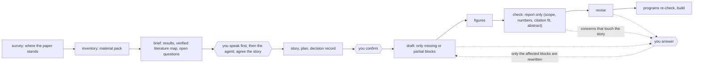

# Liber — the `/write-paper` skill for theoretical physics papers

*[English](README.md) | [中文说明](README_zh.md)*

**Liber** (Latin for the inner bark that early books were written on, and later for "book") ships one skill, **`/write-paper`**: a modular, re-entrant LaTeX drafting and deterministic verification workflow for theoretical and mathematical physics manuscripts.

**One-line install** (installs `/write-paper` into every agent it finds: Claude Code, Antigravity, Codex, OpenCode, Qwen):

```powershell
# Windows (PowerShell)
irm https://raw.githubusercontent.com/Misaka16384/liber/master/install.ps1 | iex
```

```bash
# macOS / Linux / Git Bash
curl -fsSL https://raw.githubusercontent.com/Misaka16384/liber/master/install.sh | sh
```

Then start a new agent session and type `/write-paper`. Needs Python 3.8+; a TeX distribution (`pdflatex`, `bibtex`) is needed for the build stages. Run the same line again to update.

`/write-paper` works across **Claude Code**, **OpenAI Codex CLI**, **Google Antigravity (IDE & `agy` CLI)**, **OpenCode**, **Qwen**, **`npx skills add`**, and **standalone Python CLI**.

**v4: you decide the story, AI writes and checks.** Narrative and structure are the author's call; drafting, checking, citations and the build are repetitive work for agents. Before you decide, agents give you information, not advice: the results with their evidence, a citation-verified literature map, the open questions. You say what you think first, then the agent gives its view, and you settle it together. Your decisions are recorded with what they rest on and are not treated as rules: when an agent later finds that one does not hold (weaker evidence, a reference that changes what is new, a part that cannot be written as planned), it brings it back to you as a **concern** instead of obeying or overriding silently. The workflow starts from wherever your paper stands (notes only, half written, finished) and runs only what is missing; `--effort low|medium|high` sets how much checking it does. Around that core: *PRL* / *Nature* figure gates (PyMuPDF + AST), DOI + arXiv + `.bbl` citation auditing plus a coarse-to-fine check that each citation fits its sentence (abstracts first, full text for key citations, verdicts and reading notes kept for reuse), deterministic clean-up and build, optional cross-vendor checking and context-isolated blind refereeing.

---

## Architecture



A finished paper skips the story part and goes straight to check; a half-written one gets a briefing that also says what story the draft tells now, and only its missing blocks are written. Your hand edits between runs are kept and passed to the agents as intended.

---

## Installation

### 1. One-line installer (Recommended)
Downloads Liber and installs `/write-paper` into all detected agents (`~/.claude/skills/`, `~/.codex/skills/`, `~/.agents/skills/`, `~/.gemini/config/skills/`, `~/.config/opencode/`); an existing install that you edited locally is backed up first.

**Windows (PowerShell):**
```powershell
irm https://raw.githubusercontent.com/Misaka16384/liber/master/install.ps1 | iex
# With options (only some agents, plus the Python dependencies pymupdf, matplotlib, sympy, numpy, Pillow):
& ([scriptblock]::Create((irm https://raw.githubusercontent.com/Misaka16384/liber/master/install.ps1))) -Hosts claude,antigravity -WithDeps
```

**macOS / Linux / Git Bash:**
```bash
curl -fsSL https://raw.githubusercontent.com/Misaka16384/liber/master/install.sh | sh
# With options:
curl -fsSL https://raw.githubusercontent.com/Misaka16384/liber/master/install.sh | INSTALL_DEPS=1 sh -s -- --hosts claude,antigravity
```

**From a clone** (needed for `--mode link`, which keeps the agents pointing at your checkout):
```bash
git clone https://github.com/Misaka16384/liber.git
cd liber
sh install.sh          # or .\install.ps1 on Windows
```

**Direct Python (`copy` or `link`, global or project-scoped):**
```bash
python install.py --hosts all --mode link --check-deps
python install.py --project /path/to/my-paper-repo
```

### 2. Claude Code `/plugin` or Vercel `skills` CLI
```text
# Inside Claude Code interactive session (the skill then appears as /liber:write-paper)
/plugin marketplace add Misaka16384/liber
/plugin install liber@liber

# Or via skills CLI (project or global), from your clone
npx skills add /path/to/liber -y
```

---

## Quick Start

### Option A: Use Slash Command / Skill Inside Any Agent
Open Claude Code, Codex, Antigravity, or OpenCode inside your manuscript folder and ask:
- *"Use `/write-paper` on `./notes` for a PRL Letter."* (the agent runs `auto`, then walks you through the briefing: core information first, your idea, then its view)
- *"Where does `./paper` stand? Then check it at low effort."*
- *"Run `/write-paper` `figures` on `./paper` in `nature` style."*

### Option B: Run the Cross-Agent Python Orchestrator Directly
`run_paper.py` drives `claude`, `agy` or `codex` workers; the check stage and the referee panel can run on another vendor:

```bash
# where does the paper stand? (programs only)
python skills/write-paper/scripts/run_paper.py --mode survey --paper-dir ./paper

# run what it still needs; it stops at the briefing, the story confirmation and blocking concerns.
# After each stop: discuss / confirm / answer, then run the same line again.
python skills/write-paper/scripts/run_paper.py \
  --mode auto \
  --paper-dir ./paper \
  --source-paths ./notes \
  --authority-paths ./SCOPE_AND_TRUTH.md \
  --exemplar-paths ./a_well_written_prl.tex \
  --genre letter \
  --figure-style prl

# a finished draft: a quick pass, Gemini (agy) revises, Claude checks
python skills/write-paper/scripts/run_paper.py --mode auto --from check --effort low \
  --paper-dir ./paper --source-paths ./notes --backend agy --check-backend claude

# optional: isolated blind referees on another vendor, then hand the report to the author
python skills/write-paper/scripts/run_paper.py --mode blind_referee --paper-dir ./paper --backend agy --referee-backend claude
python skills/write-paper/scripts/run_paper.py --mode revise --paper-dir ./paper \
  --repair-instructions ./paper/audit_reports/05_blind_referee_report.md
```

| Option | Meaning |
| :--- | :--- |
| `--effort low` / `medium` / `high` | low: lineage only, no scripted numeric checks, no citation-fit check, 6 agents in parallel; medium (default): lineage + neighbouring work, 4 numeric checks, citation fit from abstracts with up to 8 works read in full; high: wider map, 10 numeric checks, up to 20 works read in full, low-severity fixes, a blind referee at the end |
| `--from brief` / `story` / `draft` / `check` / `revise` / `build` | start there and run to the end (`brief` reopens the story) |
| `--only <files>` | limit draft, check and revise to these files |
| `--no-pause` | unattended: the agent picks the story itself, concerns wait in `07_feedback.json` |
| `--reference-pdfs <dir>` | PDFs named `<bibkey>.pdf`, read when a key citation needs its full text (otherwise arXiv) |
| `--citation-notes-dir <dir>` | where citation verdicts and reading notes are kept; share it across papers |

Old mode names still work (`full_auto`=`auto`, `draft_and_check`, `check_and_revise`, `blueprint`, `verify`, `citations`, `hygiene`, `repair`, `draft_and_audit`, `audit_polish`).

### Option C: Run Antigravity Native `run_workflow`
Pass `scripts/paper_workflow.py` as `ScriptPath` with `Args` matching `scripts/workflow.json`.

**Call `run_workflow` from the Planning Turn** (`Plan mode is on`), also for modes that edit files; do not `exit_plan_mode` first. From an Execution Turn, `inherit` sub-agents deadlock on `[plan review due]`. The engine detects the turn type from the session trajectory and, in an Execution Turn, sends those calls to an independent `agy` CLI session instead (or `model="pro"` if `agy` is not installed). `Args.check_backend` / `Args.referee_backend` work here too.

### Model Routing (`routing_policy`)
By default (`auto_tiered`) every agent call is routed by its task tier: `heavy` (scans, lineage, story and plan, checkers, referees, revision planning), `builder` (synthesis, the author, SM blocks, figures, numeric checks, revisions), `fast` (compile fix, JSON repair) and `probe` (pings). Antigravity uses `inherit` / `flash`; the `agy` CLI uses Gemini model ids checked against `agy models` (falling back to the CLI default if an id disappears); `claude` uses `opus` / default / `sonnet` / `haiku`; Codex keeps its default. Explicit `models[stage]` (or `--model`) always wins; `--routing-policy uniform_inherit` uses the host/CLI default everywhere.

---

## Phases

Every stage can be run on its own, also on an existing draft:

| Mode | What it does |
| :--- | :--- |
| `survey` | Programs only: each block empty / partial / full, the plan (or one derived from your `.tex` files), hand edits since the last run, open concerns, what `auto` would do next. |
| `inventory` | Material pack: `00_ground_truth_ledger.json` (every result with its exact statement, hypotheses, source and tier; merged by the program, so nothing is paraphrased), `00_redlines.md`, `00_story_material.md`; voice samples from good papers. With no notes, it is built from the paper itself. Unchanged files reuse their cached scans. |
| `brief` | Lineage and neighbouring-work agents; every reference verified by the program; what the map says each work did checked coarse to fine; then **`01_briefing.md`**: results with evidence and scope, the literature, limits and red lines, open questions. Information only: no storyline, no ranking, no advice. |
| `story` | From your discussion (`01_discussion.md`): `01_story.md`, `01_plan.json`, **`01_decisions.json`** (each decision with what it rests on), `macros.tex`. Existing files are kept; existing blocks that must change are marked. |
| `draft` | One author writes the missing, partial or marked main-text blocks in reading order (reading the complete ones for continuity), then reads it all through and writes or updates title and abstract; SM blocks in parallel. Writers may raise concerns. |
| `figures` | Builds figures with `journal_fig_theme.py` (`prl` / `nature`) + `verify_figures.py` PyMuPDF & AST gates; `auto` makes only missing ones. |
| `check` | Report only, all checkers in one parallel pool: the main text read whole and the SM in groups (scope, quantifiers, attribution, numbers, math), scripted numeric checks, a reader check of abstract and introduction, the deterministic audits, and the **citation-fit check**: each citing sentence with the cited works' abstracts and notes, judged coarse to fine (misattribution, a review cited for a priority claim, later work cited as prior, a novelty claim a cited work contradicts), with location and quote when read in full. Findings that would change the story become concerns. Writes `03_issues.json`, `audit_reports/01_check_report.md`, `audit_reports/08_citation_check.md`. |
| `revise` | The author fixes the issues (or a referee report / your notes): SM files in parallel, then the main text in one pass, abstract last; an issue that goes against one of your decisions is declined and becomes a concern. Afterwards only the programs re-check. |
| `cleanup` | Deterministic clean-up only (invisible characters, typography); no LLM rewriting. |
| `build` | Clean-up, dual `main.tex` + `supplement.tex` compile, layout and leak checks, `\status{...}`-free `main_arxiv.tex`. |
| `blind_referee` | Specialist, broad reader and editor, inside a throw-away copy holding only the manuscript, `.bib`/`.bbl`, figure PNGs and audit JSONs. |

---

## Safety Guarantees (v4)

- **Your decisions stay yours.** Agents never decide the story: a finding that touches it is filed as a concern with evidence and options; a blocking one stops the run at a stage boundary, and your answer is versioned in the decision record. Your hand edits are detected and never reverted.

- **Gates fail closed.** A citation that could not be checked (offline, rate-limited, no match) fails the citation gate unless `verify_citations.py audit --allow-offline` is given; empty or mistyped inputs fail every tool. Exit codes everywhere: `0` pass, `1` issues found (see the JSON), `2` usage/tool error.
- **No silent rewrites.** `--fix` / `--fix-braces` / `--upgrade-preprints` edit in place only what they change, keep the file's encoding and line endings, leave `@string`/`@comment`/comments/macros untouched, and store the previous version in `.wp_backups/` next to the file.
- **arXiv flattening never changes the typeset output.** Comments are cut to a bare `%` (so end-of-line spaces stay suppressed), `%` inside `\url{}`/`\verb` is kept, and `\iffalse` blocks / `comment` environments are removed.
- **Bounded agent runs.** Each headless call has a timeout (`--agent-timeout`, default 1800 s) and retries (`--agent-retries`, default 2); a failure cancels its batch and kills the whole CLI process tree. Stage 0 packs small files together and stops at `--max-scan-agents` (default 24) instead of fanning out over a data directory.
- **Claude workers are isolated from your own setup.** Headless `claude -p` workers run without auto-memory, user-level plugins/hooks/settings or MCP servers, cannot spawn sub-agents, and get a worker system prompt (user-level `CLAUDE.md` itself can only be skipped with `--bare`, which needs an API key).
- **No paraphrase layer.** The plan names results by ledger id; the program pastes the exact ledger records into each writer's and checker's prompt. Reference notes go to agents as file paths, never as excerpts cut at a fixed length.
- **Checkers cannot edit.** Read-only workers (and scripted checks) have the manuscript, `macros.tex`, `refs.bib` and the ledger, red-line, story and plan files restored if they touch them; a file changed by an edit worker assigned to a different file is restored from the checkpoint. After `revise`, `check_math_integrity.py` lists every changed formula, label or quantifier for you to review.
- **Workers stay in scope and exit cleanly.** Each worker prompt names its search scope (paper directory + the exact input paths, not their parent folders) and requires killing background tasks before finishing; every agent await (Antigravity `agent(...)` included) has a timeout, and timed-out calls are never retried because they may already have edited files.
- **Revision never loses the original wording.** Instructions are saved to a file that the router and every per-file worker read directly; text to be inserted verbatim is referenced, not paraphrased; `--repair-skip-plan` (automatic for a single `--repair-files` entry) bypasses the router.
- **`verify-entry --query` never verifies.** It lists candidates; only `--doi`/`--arxiv` (optionally with `--title`) can return `verified: true`.

---

## Deterministic CLI Verification Tools (`skills/write-paper/scripts/tools/`)

All verification scripts run completely standalone with zero LLM dependency:

1. **`verify_figures.py`** — Measures actual printed font sizes in points at 1-col (`3.375"` PRL / `3.504"` Nature) or 2-col (`7.008"` PRL / `7.205"` Nature) widths, bans `DejaVu*` and Type-3 bitmap fonts, runs in-memory text-redacted 400-DPI collision detection (capturing lines/markers crossing letters with 600-DPI zoomed crops), and scans Python scripts via AST for 10 AI-infographic patterns.
2. **`audit_tex_defs.py`** — Detects leaked internal ledger tags (`Lemma L*`, `Grade N`, `Refl-2`, uncited `Author Condition N`, `complex128`), unresolved `\ref`/`\extref`, ghost Roman sections in unnumbered PRL Letters, main-text symbols defined only in Supplemental Material, competing dual notations, and an abstract that does not read on its own (acronyms it never expands; over `--abstract-max-chars`, e.g. 600 for PRL).
3. **`check_math_integrity.py`** — State-machine lock preserving 100% of math tokens (`$...$`, `\[...\]`, equations), `\label`/`\ref`-family/`\cite`-family/`\extref`/`\status{...}`, macro definitions, ordered quantifiers in abstracts and claim environments (incl. starred and `\newtheorem` ones; on by default), and the counts of negation/strength words (`not`, `necessary`, `sufficient`, `at least`, `exponentially`, ...) and numbers anywhere in the prose.
4. **`verify_citations.py`** — Queries Crossref, INSPIRE-HEP, and HTTPS arXiv Atom APIs; cross-checks DOI and `eprint` bidirectionally (`EPRINT_DOI_MISMATCH`); verifies multi-author ordering (`AUTHOR_ORDER_MISMATCH`); handles `@book` chapter DOIs; and audits compiled `*.bbl` files for duplicate `arXiv:` strings and downcased math/proper nouns.
5. **`clean_watermarks.py`** & **`style_metrics.py`** — Strips invisible Unicode characters and fixes typography; reports copy-edit slips, stock phrases and runs of very short sentences (reports go to the author through `check`; nothing is rewritten by an LLM).
6. **`fetch_fulltext.py`** — Turns a cited work (arXiv id or a local PDF) into plain text with page markers for the fine pass of the citation check; the PDF itself is never shown to a model.
7. **`build_and_flatten_tex.py`** — Cross-platform TeX Live / MiKTeX compiler (`pdflatex -> bibtex -> pdflatex -> pdflatex`), PyMuPDF layout collision checker, APS word-equivalent counter, and clean single-file arXiv flattener stripping `\status{...}` and internal paths.

---

## License

MIT — see [LICENSE](LICENSE).
