# `/write-paper` v2 — Universal Theoretical Physics Paper Workflow & Audit Suite

*[English](README.md) | [中文说明](README_zh.md)*

A modular, re-entrant LaTeX drafting and deterministic verification workflow for theoretical and mathematical physics manuscripts. Works across **Claude Code**, **OpenAI Codex CLI**, **Google Antigravity (IDE & `agy` CLI)**, **OpenCode**, **Qwen**, **`npx skills add`**, and **standalone Python CLI**.

Instead of trusting single-pass LLM drafting or cosmetic prose perturbations, `write-paper` v2 combines **immutable Ground-Truth / Quantifier locks**, **Few-Shot exemplar voice learning**, **publication-grade *PRL* / *Nature* figure verification (PyMuPDF + AST)**, **bidirectional DOI + arXiv + `.bbl` auditing**, **context-isolated three-role blind refereeing**, and **checkpointed partial repair**.

---

## Architecture

```mermaid
flowchart LR
  S0["Stage 0: inventory (00_locks.json + Vet Lexicon)"] --> S1["Stage 1: blueprint (01_blueprint.json + Reverse GT Audit)"]
  S1 --> S2["Stage 2: draft (Few-Shot Exemplar Cadence)"]
  S2 --> S2F["Stage 2F: figures (PRL/Nature Theme + PyMuPDF/AST Gate)"]
  S2F --> S3["Stage 3: verify (Raw Authorities + SymPy + Defs)"]
  S3 --> S4["Stage 4: citations (DOI + arXiv + .bbl + Quantifier Retry)"]
  S4 --> S5["Stage 5: hygiene (Watermarks + Copy-Edit + Anti-Staccato)"]
  S5 --> Build["Build (Dual main+SM TeX + Leak-Free arXiv Flatten)"]
  Build --> Ref["Blind Referee (Isolated 3-Role / Cross-Vendor Panel)"]
  Ref --> Rep["Repair (Full Snapshot + Surgical Target Patch)"]
```



---

## Installation

```bash
git clone https://github.com/Misaka16384/liber.git
cd liber
```

### 1. Universal Auto-Installer (Recommended)
Installs cleanly into all detected agents on your machine (`~/.claude/skills/`, `~/.codex/skills/`, `~/.agents/skills/`, `~/.gemini/config/skills/`, `~/.config/opencode/`):

**Windows (PowerShell):**
```powershell
.\install.ps1
# Optional: also install Python dependencies (pymupdf, matplotlib, sympy, numpy, Pillow)
.\install.ps1 -WithDeps
```

**macOS / Linux:**
```bash
sh install.sh
# Optional: install Python dependencies first
INSTALL_DEPS=1 sh install.sh
```

**Direct Python (`copy` or `link`, global or project-scoped):**
```bash
python install.py --hosts all --mode link --check-deps
python install.py --project /path/to/my-paper-repo
```

### 2. Claude Code `/plugin` or Vercel `skills` CLI
```text
# Inside Claude Code interactive session
/plugin marketplace add Misaka16384/liber
/plugin install write-paper@write-paper

# Or via skills CLI (project or global), from your clone
npx skills add /path/to/liber -y
```

---

## Quick Start

### Option A: Use Slash Command / Skill Inside Any Agent
Open Claude Code, Codex, Antigravity, or OpenCode inside your manuscript folder and ask:
- *"Use `/write-paper` in `inventory` + `blueprint` mode on `./notes` and `./SCOPE.md` to draft a PRL Letter (`figure_style=prl`)."*
- *"Run `/write-paper` `figures` phase on `./paper` using `nature` style."*
- *"Run `/write-paper` `blind_referee` on my existing draft `./paper`."*

### Option B: Run the Cross-Agent Python Orchestrator Directly
`run_paper.py` automatically drives `claude`, `agy`, or `codex` subagents in capped parallel batches and even supports **cross-vendor blind refereeing** (e.g., draft with Claude, referee with Antigravity `agy` or Codex):

```bash
# Draft & verify an entire pipeline using Claude Code headless subagents
python skills/write-paper/scripts/run_paper.py \
  --mode draft_and_audit \
  --paper-dir ./paper \
  --source-paths ./notes \
  --authority-paths ./SCOPE_AND_TRUTH.md \
  --exemplar-paths ./group_exemplar.tex \
  --genre letter \
  --figure-style prl \
  --backend claude

# Run isolated 3-role blind refereeing using a DIFFERENT vendor CLI
python skills/write-paper/scripts/run_paper.py \
  --mode blind_referee \
  --paper-dir ./paper \
  --backend claude \
  --referee-backend agy

# Targeted post-referee repair with automatic full checkpoint backup
python skills/write-paper/scripts/run_paper.py \
  --mode repair \
  --paper-dir ./paper \
  --repair-instructions ./paper/audit_reports/05_blind_referee_report.md \
  --sync-bib ./updated_refs.bib
```

### Option C: Run Antigravity Native `run_workflow`
Pass `scripts/paper_workflow.py` as `ScriptPath` with `Args` matching `scripts/workflow.json`.

**Call `run_workflow` from the Planning Turn** (`Plan mode is on`), also for modes that edit files; do not `exit_plan_mode` first. From an Execution Turn, `inherit` sub-agents deadlock on `[plan review due]`. The engine detects the turn type from the session trajectory and, in an Execution Turn, sends those calls to an independent `agy` CLI session instead (or `model="pro"` if `agy` is not installed).

### Model Routing (`routing_policy`)
By default (`auto_tiered`) every agent call is routed by its task tier: `heavy` (scans, audits, referees, repair planning), `builder` (synthesis, blueprint, drafting, figures, fixes), `fast` (copy-edit, compile fix) and `probe` (pings). Antigravity uses `inherit` / `flash`; the `agy` CLI uses Gemini model ids checked against `agy models` (falling back to the CLI default if an id disappears); `claude` uses `opus` / default / `sonnet` / `haiku`; Codex keeps its default. Explicit `models[stage]` (or `--model`) always wins; `--routing-policy uniform_inherit` uses the host/CLI default everywhere.

---

## On-Demand Phases

Every stage can be triggered standalone on an existing `.tex` draft:

| Mode | What It Does |
| :--- | :--- |
| `inventory` | Extracts `00_ground_truth_ledger.json`, hard `00_locks.json`, Few-Shot `00_style_profile.json`, and runs **Lexicon Safety Vetting**. |
| `blueprint` | Verifies seed literature, writes `macros.tex` + `01_blueprint.json`, and runs the **Stage 1C Reverse Blueprint-vs-GT Audit Gate**. |
| `draft` | Drafts sections in capped batches (`<=4`) imitating verbatim group Few-Shot paragraphs + early `audit_tex_defs.py`. |
| `figures` | Refactors/renders plots via `journal_fig_theme.py` (`prl` / `nature`) + `verify_figures.py` PyMuPDF & AST hard gates. |
| `verify` | Audits definitions (`audit_tex_defs.py`) + 3-way cross-verification directly against raw authority files & SymPy scripts. |
| `citations` | Bidirectional DOI + arXiv + `.bbl` auditing (`verify_citations.py`) + lock-protected claim fidelity with diff-guided retry. |
| `hygiene` | Positive-ROI cleaning only: watermarks, `rank rank` / `at most <=` copy-edits, vetted non-scientific connectors, and anti-staccato check. |
| `build` | Dual `main.tex` + `supplement.tex` compile, `\letterhead \par` & mid-line collision detection, and leak-stripped `main_arxiv.tex`. |
| `blind_referee` | 3 simulated referees + format editor run inside a throw-away copy holding only the manuscript, `.bib`/`.bbl`, figure PNGs and audit JSONs (CLI backends: notes and `.workflow/` are unreadable, not just forbidden). |
| `repair` | Full timestamped snapshot backup -> targeted multi-file surgical fix -> full post-repair verification + build. |

---

## Safety Guarantees (v2.1)

- **Gates fail closed.** A citation that could not be checked (offline, rate-limited, no match) fails the citation gate unless `verify_citations.py audit --allow-offline` is given; empty or mistyped inputs fail every tool. Exit codes everywhere: `0` pass, `1` issues found (see the JSON), `2` usage/tool error.
- **No silent rewrites.** `--fix` / `--fix-braces` / `--upgrade-preprints` edit in place only what they change, keep the file's encoding and line endings, leave `@string`/`@comment`/comments/macros untouched, and store the previous version in `.wp_backups/` next to the file.
- **arXiv flattening never changes the typeset output.** Comments are cut to a bare `%` (so end-of-line spaces stay suppressed), `%` inside `\url{}`/`\verb` is kept, and `\iffalse` blocks / `comment` environments are removed.
- **Bounded agent runs.** Each headless call has a timeout (`--agent-timeout`, default 1800 s) and retries (`--agent-retries`, default 2); a failure cancels its batch and kills the whole CLI process tree. Stage 0 packs small files together and stops at `--max-scan-agents` (default 24) instead of fanning out over a data directory.
- **Claude workers are isolated from your own setup.** Headless `claude -p` workers run without auto-memory, user-level plugins/hooks/settings or MCP servers, cannot spawn sub-agents, and get a worker system prompt (user-level `CLAUDE.md` itself can only be skipped with `--bare`, which needs an API key).
- **Edits stay where they belong.** Copy-edit and claim-fidelity agents are checked by `check_math_integrity.py` (math, refs, macro bodies, quantifiers in claim environments, plus every negation/strength word and number in the prose); a file changed by an agent assigned to a different file is restored from the stage snapshot.
- **Workers stay in scope and exit cleanly.** Each worker prompt names its search scope (paper directory + the exact input paths, not their parent folders) and requires killing background tasks before finishing; every agent await (Antigravity `agent(...)` included) has a timeout, and timed-out calls are never retried because they may already have edited files.
- **Repair never loses the original wording.** The full repair instructions are saved to a file that the planner and every per-file worker read directly; text to be inserted verbatim is referenced, not paraphrased; long instructions are no longer silently truncated; `--repair-skip-plan` (automatic for a single `--repair-files` entry) bypasses the planner.
- **`verify-entry --query` never verifies.** It lists candidates; only `--doi`/`--arxiv` (optionally with `--title`) can return `verified: true`.

---

## Deterministic CLI Verification Tools (`skills/write-paper/scripts/tools/`)

All verification scripts run completely standalone with zero LLM dependency:

1. **`verify_figures.py`** — Measures actual printed font sizes in points at 1-col (`3.375"` PRL / `3.504"` Nature) or 2-col (`7.008"` PRL / `7.205"` Nature) widths, bans `DejaVu*` and Type-3 bitmap fonts, runs in-memory text-redacted 400-DPI collision detection (capturing lines/markers crossing letters with 600-DPI zoomed crops), and scans Python scripts via AST for 10 AI-infographic patterns.
2. **`audit_tex_defs.py`** — Detects leaked internal ledger tags (`Lemma L*`, `Grade N`, `Refl-2`, uncited `Author Condition N`, `complex128`), unresolved `\ref`/`\extref`, ghost Roman sections in unnumbered PRL Letters, abstract/main symbols defined only in Supplemental Material, and competing dual notations.
3. **`check_math_integrity.py`** — State-machine lock preserving 100% of math tokens (`$...$`, `\[...\]`, equations), `\label`/`\ref`-family/`\cite`-family/`\extref`/`\status{...}`, macro definitions, ordered quantifiers in abstracts and claim environments (incl. starred and `\newtheorem` ones; on by default), and the counts of negation/strength words (`not`, `necessary`, `sufficient`, `at least`, `exponentially`, ...) and numbers anywhere in the prose.
4. **`verify_citations.py`** — Queries Crossref, INSPIRE-HEP, and HTTPS arXiv Atom APIs; cross-checks DOI and `eprint` bidirectionally (`EPRINT_DOI_MISMATCH`); verifies multi-author ordering (`AUTHOR_ORDER_MISMATCH`); handles `@book` chapter DOIs; and audits compiled `*.bbl` files for duplicate `arXiv:` strings and downcased math/proper nouns.
5. **`clean_watermarks.py`** & **`style_metrics.py`** — Strips invisible Unicode watermarks, fixes typography and copy-edit defects, flags AI clichés (`delve`, `with zero ad-hoc assumptions`, etc.) and telegraphic `<=8`-word sentence clusters while never executing unsafe 4-gram destruction.
6. **`build_and_flatten_tex.py`** — Cross-platform TeX Live / MiKTeX compiler (`pdflatex -> bibtex -> pdflatex -> pdflatex`), PyMuPDF layout collision checker, APS word-equivalent counter, and clean single-file arXiv flattener stripping `\status{...}` and internal paths.

---

## License

MIT — see [LICENSE](LICENSE).
