# Liber — the `/write-paper` skill for theoretical physics papers

*[English](README.md) | [中文说明](README_zh.md)*

**Liber** (Latin for the inner bark that early books were written on, and later for "book") ships one skill, **`/write-paper`**: a modular, re-entrant LaTeX drafting and deterministic verification workflow for theoretical and mathematical physics manuscripts.

**One-line install** (installs `/write-paper` into every agent it finds: Claude Code, Antigravity, Codex, OpenCode, Qwen):

```powershell
# Windows (PowerShell)
irm https://raw.githubusercontent.com/Misaka16384/liber/master/install.ps1 | iex
```

```bash
# macOS / Linux / Git Bash
curl -fsSL https://raw.githubusercontent.com/Misaka16384/liber/master/install.sh | sh
```

Then start a new agent session and type `/write-paper`. Needs Python 3.8+; a TeX distribution (`pdflatex`, `bibtex`) is needed for the build stages. Run the same line again to update.

`/write-paper` works across **Claude Code**, **OpenAI Codex CLI**, **Google Antigravity (IDE & `agy` CLI)**, **OpenCode**, **Qwen**, **`npx skills add`**, and **standalone Python CLI**.

**v3: write first, check afterwards.** A writer facing a long list of hard rules writes a checklist, not a paper. So `/write-paper` gives the writer material (the exact results, the story, a verified history of the question, the notation) and three bottom lines, and checks everything else after the text exists: length limits, acronyms in the abstract, scope and quantifiers, attribution, numbers. Checkers only report; the author fixes, with the smallest edit that keeps the story. Around that core: *PRL* / *Nature* figure gates (PyMuPDF + AST), DOI + arXiv + `.bbl` citation auditing, deterministic clean-up and build, optional cross-vendor checking and context-isolated blind refereeing.

---

## Architecture

```mermaid
flowchart LR
  S0["inventory: material pack (ledger, red lines, story material)"] --> S1["story: verified lineage, one-page story, block plan"]
  S1 --> P{{"you read 01_story.md"}}
  P --> S2["draft: one author, block by block (SM in parallel)"]
  S2 --> F["figures (PRL/Nature theme + PyMuPDF/AST gate)"]
  F --> C["check: report only (scope, numbers, citations, abstract read alone)"]
  C --> R["revise: one author fixes the main text in one pass"]
  R --> C2["programs re-check"] --> B["build (clean-up, dual compile, arXiv flatten)"]
  B -.-> Ref["blind_referee, when you ask (isolated, optionally cross-vendor)"] -.-> R
```



The whole story is written first and checked once, all checkers in one parallel pool. A second LLM check and the referee panel run only when you ask.

---

## Installation

### 1. One-line installer (Recommended)
Downloads Liber and installs `/write-paper` into all detected agents (`~/.claude/skills/`, `~/.codex/skills/`, `~/.agents/skills/`, `~/.gemini/config/skills/`, `~/.config/opencode/`); an existing install that you edited locally is backed up first.

**Windows (PowerShell):**
```powershell
irm https://raw.githubusercontent.com/Misaka16384/liber/master/install.ps1 | iex
# With options (only some agents, plus the Python dependencies pymupdf, matplotlib, sympy, numpy, Pillow):
& ([scriptblock]::Create((irm https://raw.githubusercontent.com/Misaka16384/liber/master/install.ps1))) -Hosts claude,antigravity -WithDeps
```

**macOS / Linux / Git Bash:**
```bash
curl -fsSL https://raw.githubusercontent.com/Misaka16384/liber/master/install.sh | sh
# With options:
curl -fsSL https://raw.githubusercontent.com/Misaka16384/liber/master/install.sh | INSTALL_DEPS=1 sh -s -- --hosts claude,antigravity
```

**From a clone** (needed for `--mode link`, which keeps the agents pointing at your checkout):
```bash
git clone https://github.com/Misaka16384/liber.git
cd liber
sh install.sh          # or .\install.ps1 on Windows
```

**Direct Python (`copy` or `link`, global or project-scoped):**
```bash
python install.py --hosts all --mode link --check-deps
python install.py --project /path/to/my-paper-repo
```

### 2. Claude Code `/plugin` or Vercel `skills` CLI
```text
# Inside Claude Code interactive session (the skill then appears as /liber:write-paper)
/plugin marketplace add Misaka16384/liber
/plugin install liber@liber

# Or via skills CLI (project or global), from your clone
npx skills add /path/to/liber -y
```

---

## Quick Start

### Option A: Use Slash Command / Skill Inside Any Agent
Open Claude Code, Codex, Antigravity, or OpenCode inside your manuscript folder and ask:
- *"Use `/write-paper` (`inventory` + `story`) on `./notes` and `./SCOPE.md` for a PRL Letter, and show me the story before drafting."*
- *"Run `/write-paper` `check` on my draft `./paper` and give me the issue list."*
- *"Run `/write-paper` `figures` on `./paper` in `nature` style."*

### Option B: Run the Cross-Agent Python Orchestrator Directly
`run_paper.py` drives `claude`, `agy` or `codex` workers; the check stage and the referee panel can run on another vendor:

```bash
# 1. Material pack, verified lineage, one-page story and block plan; stops for you to read .workflow/01_story.md
python skills/write-paper/scripts/run_paper.py \
  --mode full_auto \
  --paper-dir ./paper \
  --source-paths ./notes \
  --authority-paths ./SCOPE_AND_TRUTH.md \
  --exemplar-paths ./a_well_written_prl.tex \
  --genre letter \
  --figure-style prl

# 2. After reading (and editing) the story: draft, figures, check, revise, deterministic re-check, build.
#    Gemini (agy) writes, Claude checks.
python skills/write-paper/scripts/run_paper.py \
  --mode draft_and_check \
  --paper-dir ./paper \
  --source-paths ./notes \
  --authority-paths ./SCOPE_AND_TRUTH.md \
  --genre letter \
  --backend agy \
  --check-backend claude

# 3. Optional: isolated blind referees on a different vendor, then hand the report to the author
python skills/write-paper/scripts/run_paper.py --mode blind_referee --paper-dir ./paper --backend agy --referee-backend claude
python skills/write-paper/scripts/run_paper.py --mode revise --paper-dir ./paper \
  --repair-instructions ./paper/audit_reports/05_blind_referee_report.md
```

`--no-pause` runs `full_auto` straight through. For one paper, step 1 runs once (unchanged notes are not rescanned); step 2 can be repeated. `--max-parallel 6` (up to 8) speeds up every parallel phase if your API quota allows. Old mode names still work (`blueprint`, `verify`, `citations`, `hygiene`, `repair`, `draft_and_audit`, `audit_polish`).

### Option C: Run Antigravity Native `run_workflow`
Pass `scripts/paper_workflow.py` as `ScriptPath` with `Args` matching `scripts/workflow.json`.

**Call `run_workflow` from the Planning Turn** (`Plan mode is on`), also for modes that edit files; do not `exit_plan_mode` first. From an Execution Turn, `inherit` sub-agents deadlock on `[plan review due]`. The engine detects the turn type from the session trajectory and, in an Execution Turn, sends those calls to an independent `agy` CLI session instead (or `model="pro"` if `agy` is not installed). `Args.check_backend` / `Args.referee_backend` work here too.

### Model Routing (`routing_policy`)
By default (`auto_tiered`) every agent call is routed by its task tier: `heavy` (scans, lineage, story and plan, checkers, referees, revision planning), `builder` (synthesis, the author, SM blocks, figures, numeric checks, revisions), `fast` (compile fix, JSON repair) and `probe` (pings). Antigravity uses `inherit` / `flash`; the `agy` CLI uses Gemini model ids checked against `agy models` (falling back to the CLI default if an id disappears); `claude` uses `opus` / default / `sonnet` / `haiku`; Codex keeps its default. Explicit `models[stage]` (or `--model`) always wins; `--routing-policy uniform_inherit` uses the host/CLI default everywhere.

---

## Phases

Every stage can be run on its own, also on an existing draft:

| Mode | What it does |
| :--- | :--- |
| `inventory` | Material pack: `00_ground_truth_ledger.json` (every result with its exact statement, hypotheses, source and tier; merged by the program from the scans, so nothing is paraphrased), `00_redlines.md` (your prohibitions: the only rule list writers see), `00_story_material.md` (motivation, pictures, surprises, history in your notes); voice samples from good papers. Unchanged notes reuse their cached scans. |
| `story` | Traces 4-8 historical steps and verifies each reference itself; writes **`01_story.md`** (one page: the question, its history, why it is open, the answer in words, why it matters, what goes where) and `01_plan.json` (blocks that name results by ledger id only), plus `macros.tex`. `full_auto` pauses here. |
| `draft` | One author writes the main text block by block in reading order, then reads it all through and writes title and abstract for what is there; the Supplemental Material is written in parallel, rigour first. Each block gets the exact ledger records, never a paraphrase. |
| `figures` | Builds figures with `journal_fig_theme.py` (`prl` / `nature`) + `verify_figures.py` PyMuPDF & AST gates. |
| `check` | One pass over the finished text, report only, all checkers in one parallel pool: the whole main text read by one checker and the Supplemental Material in groups of about 60 KB, against the ledger and your original files (scope, quantifiers, attribution, numbers, math); scripted SymPy/numeric checks of up to 4 core results (`--max-numeric-checks`); a reader check of abstract and introduction; plus the deterministic audits (abstract read alone: acronyms and the 600-character PRL limit; definitions; citations). Writes `03_issues.json` and `audit_reports/01_check_report.md`. |
| `revise` | The author fixes the issues (or a referee report / your notes): Supplemental Material files in parallel, then one author reads the whole main text and fixes it in one pass, abstract last; smallest edit, keeps the story; may decline a mistaken issue with a reason; files with only low-severity issues are skipped (`--revise-low` includes them); math changes are listed for you. Afterwards only the programs re-check. |
| `cleanup` | Deterministic clean-up only (invisible characters, typography); no LLM rewriting. |
| `build` | Clean-up, dual `main.tex` + `supplement.tex` compile, layout and leak checks, `\status{...}`-free `main_arxiv.tex`. |
| `blind_referee` | Specialist, broad reader (who first answers: what, why, how far earlier work got, what is new) and editor, inside a throw-away copy holding only the manuscript, `.bib`/`.bbl`, figure PNGs and audit JSONs. |

---

## Safety Guarantees (v3)

- **Gates fail closed.** A citation that could not be checked (offline, rate-limited, no match) fails the citation gate unless `verify_citations.py audit --allow-offline` is given; empty or mistyped inputs fail every tool. Exit codes everywhere: `0` pass, `1` issues found (see the JSON), `2` usage/tool error.
- **No silent rewrites.** `--fix` / `--fix-braces` / `--upgrade-preprints` edit in place only what they change, keep the file's encoding and line endings, leave `@string`/`@comment`/comments/macros untouched, and store the previous version in `.wp_backups/` next to the file.
- **arXiv flattening never changes the typeset output.** Comments are cut to a bare `%` (so end-of-line spaces stay suppressed), `%` inside `\url{}`/`\verb` is kept, and `\iffalse` blocks / `comment` environments are removed.
- **Bounded agent runs.** Each headless call has a timeout (`--agent-timeout`, default 1800 s) and retries (`--agent-retries`, default 2); a failure cancels its batch and kills the whole CLI process tree. Stage 0 packs small files together and stops at `--max-scan-agents` (default 24) instead of fanning out over a data directory.
- **Claude workers are isolated from your own setup.** Headless `claude -p` workers run without auto-memory, user-level plugins/hooks/settings or MCP servers, cannot spawn sub-agents, and get a worker system prompt (user-level `CLAUDE.md` itself can only be skipped with `--bare`, which needs an API key).
- **No paraphrase layer.** The plan names results by ledger id; the program pastes the exact ledger records into each writer's and checker's prompt. Reference notes go to agents as file paths, never as excerpts cut at a fixed length.
- **Checkers cannot edit.** Read-only workers (and scripted checks) have the manuscript, `macros.tex`, `refs.bib` and the ledger, red-line, story and plan files restored if they touch them; a file changed by an edit worker assigned to a different file is restored from the checkpoint. After `revise`, `check_math_integrity.py` lists every changed formula, label or quantifier for you to review.
- **Workers stay in scope and exit cleanly.** Each worker prompt names its search scope (paper directory + the exact input paths, not their parent folders) and requires killing background tasks before finishing; every agent await (Antigravity `agent(...)` included) has a timeout, and timed-out calls are never retried because they may already have edited files.
- **Revision never loses the original wording.** Instructions are saved to a file that the router and every per-file worker read directly; text to be inserted verbatim is referenced, not paraphrased; `--repair-skip-plan` (automatic for a single `--repair-files` entry) bypasses the router.
- **`verify-entry --query` never verifies.** It lists candidates; only `--doi`/`--arxiv` (optionally with `--title`) can return `verified: true`.

---

## Deterministic CLI Verification Tools (`skills/write-paper/scripts/tools/`)

All verification scripts run completely standalone with zero LLM dependency:

1. **`verify_figures.py`** — Measures actual printed font sizes in points at 1-col (`3.375"` PRL / `3.504"` Nature) or 2-col (`7.008"` PRL / `7.205"` Nature) widths, bans `DejaVu*` and Type-3 bitmap fonts, runs in-memory text-redacted 400-DPI collision detection (capturing lines/markers crossing letters with 600-DPI zoomed crops), and scans Python scripts via AST for 10 AI-infographic patterns.
2. **`audit_tex_defs.py`** — Detects leaked internal ledger tags (`Lemma L*`, `Grade N`, `Refl-2`, uncited `Author Condition N`, `complex128`), unresolved `\ref`/`\extref`, ghost Roman sections in unnumbered PRL Letters, main-text symbols defined only in Supplemental Material, competing dual notations, and an abstract that does not read on its own (acronyms it never expands; over `--abstract-max-chars`, e.g. 600 for PRL).
3. **`check_math_integrity.py`** — State-machine lock preserving 100% of math tokens (`$...$`, `\[...\]`, equations), `\label`/`\ref`-family/`\cite`-family/`\extref`/`\status{...}`, macro definitions, ordered quantifiers in abstracts and claim environments (incl. starred and `\newtheorem` ones; on by default), and the counts of negation/strength words (`not`, `necessary`, `sufficient`, `at least`, `exponentially`, ...) and numbers anywhere in the prose.
4. **`verify_citations.py`** — Queries Crossref, INSPIRE-HEP, and HTTPS arXiv Atom APIs; cross-checks DOI and `eprint` bidirectionally (`EPRINT_DOI_MISMATCH`); verifies multi-author ordering (`AUTHOR_ORDER_MISMATCH`); handles `@book` chapter DOIs; and audits compiled `*.bbl` files for duplicate `arXiv:` strings and downcased math/proper nouns.
5. **`clean_watermarks.py`** & **`style_metrics.py`** — Strips invisible Unicode characters and fixes typography; reports copy-edit slips, stock phrases and runs of very short sentences (reports go to the author through `check`; nothing is rewritten by an LLM).
6. **`build_and_flatten_tex.py`** — Cross-platform TeX Live / MiKTeX compiler (`pdflatex -> bibtex -> pdflatex -> pdflatex`), PyMuPDF layout collision checker, APS word-equivalent counter, and clean single-file arXiv flattener stripping `\status{...}` and internal paths.

---

## License

MIT — see [LICENSE](LICENSE).
