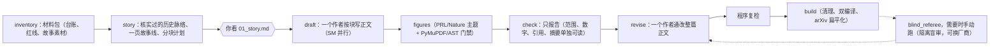

# Liber —— 理论物理论文写作 skill `/write-paper`

*[English](README.md) | [中文说明](README_zh.md)*

**Liber**（拉丁文，原指树皮内层，古人在上面写字，后来引申为“书”）提供一个 skill：**`/write-paper`**。

**一键安装**（自动装进本机找到的所有 Agent：Claude Code、Antigravity、Codex、OpenCode、Qwen）：

```powershell
# Windows（PowerShell）
irm https://raw.githubusercontent.com/Misaka16384/liber/master/install.ps1 | iex
```

```bash
# macOS / Linux / Git Bash
curl -fsSL https://raw.githubusercontent.com/Misaka16384/liber/master/install.sh | sh
```

装好后新开一个 Agent 会话，输入 `/write-paper` 即可。需要 Python 3.8 以上；编译相关阶段还需要 TeX 发行版（`pdflatex`、`bibtex`）。再运行一次同一条命令就是更新。

`/write-paper` 是一套模块化、支持任意阶段按需重入的理论物理与数学物理 LaTeX 论文工作流与确定性验证工具链，原生兼容 **Claude Code**、**OpenAI Codex CLI**、**Google Antigravity（IDE 与 `agy` CLI）**、**OpenCode**、**Qwen**、**`npx skills add`** 及 **独立 Python CLI**。

**v3 的思路：先写，后查。** 写作时如果面对一长串硬规定，写出来的就是一张清单，而不是论文。所以写作 agent 只拿到材料（结论原文、故事线、核实过的历史脉络、记号）和三条底线；其余能查的东西都留到写完再查：字数和字符数、摘要里的缩写、结论的范围和量词、引用归属、数字。查错只出问题清单，由作者按最小改动修改，保住叙事。外围照旧：*PRL* / *Nature* 图件门禁（PyMuPDF + AST）、DOI + arXiv + `.bbl` 引用审计、确定性清理与编译，以及可选的换厂商查错和上下文隔离盲审。



整篇故事先写完，再集中查一次，所有核查员放在同一个并行池里跑。第二遍模型查错和盲审只在你需要时手动运行。

---

## 安装

### 1. 一行命令安装（推荐）
自动下载 Liber，把 `/write-paper` 部署到 `~/.claude/skills/`、`~/.codex/skills/`、`~/.agents/skills/`、`~/.gemini/config/skills/` 与 `~/.config/opencode/`。如果你本地改过已安装的版本，会先自动备份。

**Windows（PowerShell）：**
```powershell
irm https://raw.githubusercontent.com/Misaka16384/liber/master/install.ps1 | iex
# 带参数（只装部分 Agent，并顺便安装 Python 依赖 pymupdf, matplotlib, sympy, numpy, Pillow）：
& ([scriptblock]::Create((irm https://raw.githubusercontent.com/Misaka16384/liber/master/install.ps1))) -Hosts claude,antigravity -WithDeps
```

**macOS / Linux / Git Bash：**
```bash
curl -fsSL https://raw.githubusercontent.com/Misaka16384/liber/master/install.sh | sh
# 带参数：
curl -fsSL https://raw.githubusercontent.com/Misaka16384/liber/master/install.sh | INSTALL_DEPS=1 sh -s -- --hosts claude,antigravity
```

**从克隆目录安装**（需要 `--mode link` 软链接、让 Agent 直接用你的工作副本时用这种）：
```bash
git clone https://github.com/Misaka16384/liber.git
cd liber
sh install.sh          # Windows 上用 .\install.ps1
```

**指定宿主 / 软链接模式 / 仅项目级安装：**
```bash
python install.py --hosts all --mode link --check-deps
python install.py --project /path/to/my-paper-repo
```

### 2. Claude Code `/plugin` 或 `skills` CLI
```text
# 在 Claude Code 内通过插件安装（装好后 skill 显示为 /liber:write-paper）：
/plugin marketplace add Misaka16384/liber
/plugin install liber@liber

# 或使用 npx skills（指向你克隆下来的目录）：
npx skills add /path/to/liber -y
```

---

## 三种运行方式

### 方式一：在 Claude / Codex / Antigravity / OpenCode 对话中自然触发
在论文项目目录打开任意 Agent，直接描述需求或用 `/write-paper` 调用单个阶段：
- *「用 `/write-paper` 的 `inventory` 和 `story` 阶段读取 `./notes` 与 `./SCOPE.md`，按 PRL Letter 规划，起草前先给我看故事线。」*
- *「对 `./paper` 跑 `/write-paper` 的 `check`，把问题清单给我。」*
- *「只对 `./paper` 跑 `figures` 阶段，按 `nature` 风格作图并用 PyMuPDF 验图。」*

### 方式二：跨 Agent 命令行总控（支持换厂商查错和盲审）
通过 `scripts/run_paper.py` 调起 `claude`、`agy` 或 `codex` 子进程；查错阶段和盲审都可以交给另一家模型：

```bash
# 1. 材料包、核实过的历史脉络、一页故事线和分块计划；跑完停下，等你看 .workflow/01_story.md
python skills/write-paper/scripts/run_paper.py \
  --mode full_auto \
  --paper-dir ./paper \
  --source-paths ./notes \
  --authority-paths ./SCOPE_AND_TRUTH.md \
  --exemplar-paths ./a_well_written_prl.tex \
  --genre letter \
  --figure-style prl

# 2. 看完（可直接改）故事线后：起草、作图、查错、修改、程序复检、编译。agy 写，Claude 查
python skills/write-paper/scripts/run_paper.py \
  --mode draft_and_check \
  --paper-dir ./paper \
  --source-paths ./notes \
  --authority-paths ./SCOPE_AND_TRUTH.md \
  --genre letter \
  --backend agy \
  --check-backend claude

# 3. 可选：换一家模型做隔离盲审，再把审稿报告交给作者修改
python skills/write-paper/scripts/run_paper.py --mode blind_referee --paper-dir ./paper --backend agy --referee-backend claude
python skills/write-paper/scripts/run_paper.py --mode revise --paper-dir ./paper \
  --repair-instructions ./paper/audit_reports/05_blind_referee_report.md
```

加 `--no-pause` 可让 `full_auto` 不停顿一路跑完。一篇论文第 1 步通常只跑一次（笔记没变的文件不会重新扫描），第 2 步可以反复跑。API 额度允许时加 `--max-parallel 6`（最大 8），所有并行阶段都会更快。旧的阶段名仍可用（`blueprint`、`verify`、`citations`、`hygiene`、`repair`、`draft_and_audit`、`audit_polish`）。

### 方式三：Antigravity 原生 `run_workflow`
以 `ScriptPath="<SKILL_DIR>/scripts/paper_workflow.py"` 调用 `run_workflow`，`Args` 见 `scripts/workflow.json`。

**请在规划回合（`Plan mode is on`）里直接调用 `run_workflow`**，即使这个阶段要改文件，也不要先调用 `exit_plan_mode`。原因是：在执行回合里，`inherit` 子 agent 没有计划记录，会卡在 `[plan review due]`。引擎启动时也会读取会话轨迹自行判断回合类型（可用 `Args.plan_mode = "on" | "off"` 手动指定）。若判断为执行回合，本该用 `inherit` 的调用会改走独立的 `agy` CLI 会话；本机没装 `agy` 时退回 `model="pro"`。`Args.check_backend` / `Args.referee_backend` 在这里同样有效。

### 模型分流（`routing_policy`）
默认 `auto_tiered`：每个 agent 调用按任务档位选模型。
- `heavy`：扫描、历史脉络、故事线和分块计划、查错、读者检查、盲审、修改路由。
- `builder`：材料合成、作者、SM 分块、作图、数值核验脚本、修改。
- `fast`：编译修复、JSON 修复。
- `probe`：连通性测试。

各运行环境的选择：
- Antigravity 用 `inherit` 或 `flash`。
- `agy` CLI 用 Gemini 模型 ID，每次运行先用 `agy models` 校验一次，模型下线时自动改用 CLI 默认模型。
- `claude` 分别用 `opus`、默认模型、`sonnet`、`haiku`。
- Codex 保持默认配置。

显式指定的 `models[阶段]`（或 `--model`）优先级最高；`--routing-policy uniform_inherit` 则全部使用宿主或 CLI 的默认模型。档位只决定模型，能否写文件由每个调用点单独控制。

---

## 各阶段（都可单独运行，也可接管已有草稿）

| 阶段 (`--mode`) | 做什么 |
| :--- | :--- |
| `inventory` | 材料包：`00_ground_truth_ledger.json`（每条结论的原文、前提、出处和层级；由程序把扫描结果直接合并，不经转述）、`00_redlines.md`（你的禁令，也是写作者看到的唯一一份规则）、`00_story_material.md`（笔记里的动机、物理图像、意外发现、历史）；从好论文里挑出风格示例段落。笔记没变的文件沿用上次的扫描结果。 |
| `story` | 整理 4–8 步历史脉络，每篇文献由流程自己核实；写 **`01_story.md`**（一页：问题、历史、为什么至今没解决、大白话的答案、意义、什么放正文什么放 SM）和 `01_plan.json`（分块计划，只用台账编号指代结论），以及 `macros.tex`。`full_auto` 在这里停下。 |
| `draft` | 一个作者按阅读顺序逐块写正文，最后一轮先通读全文，再按定稿写标题和摘要；补充材料并行写，严谨优先。每块拿到的是台账原文，不是转述。 |
| `figures` | 按 `prl` / `nature` 视觉规范作图，过 `verify_figures.py` PyMuPDF 印刷字号 + 矢量碰撞 + AST 门禁。 |
| `check` | 全文写完后集中查一次，只报告，所有核查员放在同一个并行池：正文由一个核查员整篇通读，补充材料按约 60 KB 一组；对照台账和原始文件查范围、量词、归属、数字和数学；最多 4 个核心结论跑 SymPy/数值脚本（`--max-numeric-checks`）；读者视角检查摘要和引言；再加确定性检查（摘要单独可读：缩写、PRL 600 字符；未定义符号；引用）。输出 `03_issues.json` 和 `audit_reports/01_check_report.md`。 |
| `revise` | 作者按问题清单（或审稿报告、你的意见）修改：补充材料各文件并行改，正文由一个作者通读后一次改完，摘要最后；最小改动、保住叙事；认为是误报可以拒绝并写理由；只有低优先级问题的文件默认跳过（`--revise-low` 才改）；改动过的公式会列出来给你看。改完只由程序复检。 |
| `cleanup` | 只做确定性清理（零宽字符、排版符号），没有 LLM 改写。 |
| `build` | 清理后 `main.tex + supplement.tex` 双编译，检查版面和泄露，输出去掉 `\status{...}` 的 `main_arxiv.tex`。 |
| `blind_referee` | 小同行、大同行（先回答：问题是什么、为什么重要、前人到哪、新在哪）和编辑三方，在只含稿件、`.bib`/`.bbl`、图片 PNG 和审计 JSON 的临时副本里审稿。 |

---

## 独立 Python 确定性工具链（零 LLM 依赖即可运行）

所有工具均位于 `skills/write-paper/scripts/tools/`：
- `verify_figures.py` & `journal_fig_theme.py`：PyMuPDF 按实际印刷栏宽核算真实 pt 字号、封禁 `DejaVu`/Type-3、擦字留线检测箭头/曲线穿字碰撞并裁剪 600 DPI 放大图、AST 拦截 10 类 AI 信息图特征。
- `audit_tex_defs.py`：跨正文/SM 检测 `Lemma L*`/`Grade N`/`complex128` 泄露、`\ref`/`\extref` 悬空、PRL 幽灵章节、仅在 SM 定义而正文未定义的符号、双记号混用，以及摘要能否单独读懂（未展开的缩写；超过 `--abstract-max-chars`，PRL 为 600）。
- `check_math_integrity.py`：对比修改前后，列出所有公式、标签、引用和定理量词的变化。
- `verify_citations.py`：Crossref / INSPIRE-HEP / HTTPS arXiv API 双向比对 DOI 与 `eprint`，校验多作者顺序，扫描渲染后 `.bbl` 的重复 `arXiv:` 与数学符号小写塌缩。
- `clean_watermarks.py` & `style_metrics.py`：清理隐形字符、修正排版符号；报告笔误、套话和连串短句（通过 `check` 交给作者，不由 LLM 改写）。
- `build_and_flatten_tex.py`：跨平台自动定位 TeX Live / MiKTeX 完成双编译、检测行中标题碰撞，并输出无内部路径残留的提交单文件。
