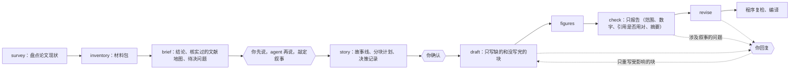

# Liber —— 理论物理论文写作 skill `/write-paper`

*[English](README.md) | [中文说明](README_zh.md) | [它能做什么（使用说明）](GUIDE_zh.md)*

**Liber**（拉丁文，原指树皮内层，古人在上面写字，后来引申为“书”）提供一个 skill：**`/write-paper`**。

**一键安装**（自动装进本机找到的所有 Agent：Claude Code、Antigravity、Codex、OpenCode、Qwen）：

```powershell
# Windows（PowerShell）
irm https://raw.githubusercontent.com/Misaka16384/liber/master/install.ps1 | iex
```

```bash
# macOS / Linux / Git Bash
curl -fsSL https://raw.githubusercontent.com/Misaka16384/liber/master/install.sh | sh
```

装好后新开一个 Agent 会话，输入 `/write-paper` 即可。需要 Python 3.8 以上；编译相关阶段还需要 TeX 发行版（`pdflatex`、`bibtex`）。再运行一次同一条命令就是更新。

`/write-paper` 是一套模块化、支持任意阶段按需重入的理论物理与数学物理 LaTeX 论文工作流与确定性验证工具链，原生兼容 **Claude Code**、**OpenAI Codex CLI**、**Google Antigravity（IDE 与 `agy` CLI）**、**OpenCode**、**Qwen**、**`npx skills add`** 及 **独立 Python CLI**。

**v4 的思路：叙事你来定，写和查交给 AI。** 讲什么、怎么组织由作者决定；起草、核查、引用、编译这些重复劳动交给 agent。你做决定之前，agent 只提供信息，不给建议：结论及其证据强度、核实过的文献地图、待决问题。你先说想法，agent 再说它的看法，然后一起敲定。你的决定会连同当时的依据一起记下，但不被当成规则：之后 agent 发现某条决定站不住（证据比想的弱、某篇文献改变了新意、某块按计划写不下去），会带着证据和选项回来问你（**反馈**），既不默默照办，也不默默推翻。流程从论文当前的完成度出发（只有笔记、写了一半、基本写完），只跑缺的部分；`--effort low|medium|high` 控制查得多细。外围：*PRL* / *Nature* 图件门禁（PyMuPDF + AST）、DOI + arXiv + `.bbl` 引用审计，以及从粗到细的"引用是否用对"检查（先看摘要，关键引用读原文，核查结论和读书笔记存档复用）、确定性清理与编译、可选的换厂商查错和上下文隔离盲审。



基本写完的论文跳过叙事环节，直接核查；写了一半的论文，简报里会多一节"现有稿子在讲什么故事"，之后只补缺的块。两次运行之间你手改的地方会被识别出来，作为你的意图交给 agent，不会被改回去。

---

## 安装

### 1. 一行命令安装（推荐）
自动下载 Liber，把 `/write-paper` 部署到 `~/.claude/skills/`、`~/.codex/skills/`、`~/.agents/skills/`、`~/.gemini/config/skills/` 与 `~/.config/opencode/`。如果你本地改过已安装的版本，会先自动备份。

**Windows（PowerShell）：**
```powershell
irm https://raw.githubusercontent.com/Misaka16384/liber/master/install.ps1 | iex
# 带参数（只装部分 Agent，并顺便安装 Python 依赖 pymupdf, matplotlib, sympy, numpy, Pillow）：
& ([scriptblock]::Create((irm https://raw.githubusercontent.com/Misaka16384/liber/master/install.ps1))) -Hosts claude,antigravity -WithDeps
```

**macOS / Linux / Git Bash：**
```bash
curl -fsSL https://raw.githubusercontent.com/Misaka16384/liber/master/install.sh | sh
# 带参数：
curl -fsSL https://raw.githubusercontent.com/Misaka16384/liber/master/install.sh | INSTALL_DEPS=1 sh -s -- --hosts claude,antigravity
```

**从克隆目录安装**（需要 `--mode link` 软链接、让 Agent 直接用你的工作副本时用这种）：
```bash
git clone https://github.com/Misaka16384/liber.git
cd liber
sh install.sh          # Windows 上用 .\install.ps1
```

**指定宿主 / 软链接模式 / 仅项目级安装：**
```bash
python install.py --hosts all --mode link --check-deps
python install.py --project /path/to/my-paper-repo
```

### 2. Claude Code `/plugin` 或 `skills` CLI
```text
# 在 Claude Code 内通过插件安装（装好后 skill 显示为 /liber:write-paper）：
/plugin marketplace add Misaka16384/liber
/plugin install liber@liber

# 或使用 npx skills（指向你克隆下来的目录）：
npx skills add /path/to/liber -y
```

---

## 三种运行方式

### 方式一：在 Claude / Codex / Antigravity / OpenCode 对话中自然触发
在论文项目目录打开任意 Agent，直接描述需求：
- *「用 `/write-paper` 处理 `./notes`，按 PRL Letter 写。」*（agent 跑 `auto`，到简报处停下，先讲核心信息，等你说完想法再给它的看法）
- *「看看 `./paper` 现在到哪一步了，然后用 low effort 查一遍。」*
- *「只对 `./paper` 跑 `figures` 阶段，按 `nature` 风格作图并用 PyMuPDF 验图。」*

### 方式二：跨 Agent 命令行总控（支持换厂商查错和盲审）
通过 `scripts/run_paper.py` 调起 `claude`、`agy` 或 `codex` 子进程；查错阶段和盲审都可以交给另一家模型：

```bash
# 论文现在到哪一步了（只跑程序）
python skills/write-paper/scripts/run_paper.py --mode survey --paper-dir ./paper

# 跑它还缺的部分；会在简报、叙事确认、阻断级反馈三处停下。每次停下后讨论 / 确认 / 回复，再跑同一条命令
python skills/write-paper/scripts/run_paper.py \
  --mode auto \
  --paper-dir ./paper \
  --source-paths ./notes \
  --authority-paths ./SCOPE_AND_TRUTH.md \
  --exemplar-paths ./a_well_written_prl.tex \
  --genre letter \
  --figure-style prl

# 已经写完的稿子：快速过一遍，agy 修改，Claude 查
python skills/write-paper/scripts/run_paper.py --mode auto --from check --effort low \
  --paper-dir ./paper --source-paths ./notes --backend agy --check-backend claude

# 可选：换一家模型做隔离盲审，再把审稿报告交给作者修改
python skills/write-paper/scripts/run_paper.py --mode blind_referee --paper-dir ./paper --backend agy --referee-backend claude
python skills/write-paper/scripts/run_paper.py --mode revise --paper-dir ./paper \
  --repair-instructions ./paper/audit_reports/05_blind_referee_report.md
```

| 选项 | 含义 |
| :--- | :--- |
| `--effort low` / `medium` / `high` | low：只整理历史脉络，不跑数值脚本，不查引用是否用对，6 路并行；medium（默认）：历史脉络加相邻工作，4 个数值脚本，引用先按摘要粗筛，最多读 8 篇原文；high：更宽的文献地图，10 个数值脚本，最多读 20 篇原文，低优先级问题也改，最后加一轮盲审 |
| `--from brief` / `story` / `draft` / `check` / `revise` / `build` | 从这一步开始跑到底（`brief` 会重新打开叙事讨论） |
| `--only <文件>` | 起草、核查、修改只针对这些文件 |
| `--no-pause` | 无人值守：叙事由 agent 自己定，反馈留在 `07_feedback.json` 里 |
| `--reference-pdfs <目录>` | 以 `<bibkey>.pdf` 命名的原文 PDF，关键引用需要读原文时优先用（否则从 arXiv 取） |
| `--citation-notes-dir <目录>` | 引用核查结论和读书笔记的存放处；多篇论文共用一个目录即可复用 |

旧的阶段名仍可用（`full_auto`=`auto`、`draft_and_check`、`check_and_revise`、`blueprint`、`verify`、`citations`、`hygiene`、`repair`、`draft_and_audit`、`audit_polish`）。

### 方式三：Antigravity 原生 `run_workflow`
以 `ScriptPath="<SKILL_DIR>/scripts/paper_workflow.py"` 调用 `run_workflow`，`Args` 见 `scripts/workflow.json`。

**请在规划回合（`Plan mode is on`）里直接调用 `run_workflow`**，即使这个阶段要改文件，也不要先调用 `exit_plan_mode`。原因是：在执行回合里，`inherit` 子 agent 没有计划记录，会卡在 `[plan review due]`。引擎启动时也会读取会话轨迹自行判断回合类型（可用 `Args.plan_mode = "on" | "off"` 手动指定）。若判断为执行回合，本该用 `inherit` 的调用会改走独立的 `agy` CLI 会话；本机没装 `agy` 时退回 `model="pro"`。`Args.check_backend` / `Args.referee_backend` 在这里同样有效。

### 模型分流（`routing_policy`）
默认 `auto_tiered`：每个 agent 调用按任务档位选模型。
- `heavy`：扫描、历史脉络、故事线和分块计划、查错、读者检查、盲审、修改路由。
- `builder`：材料合成、作者、SM 分块、作图、数值核验脚本、修改。
- `fast`：编译修复、JSON 修复。
- `probe`：连通性测试。

各运行环境的选择：
- Antigravity 用 `inherit` 或 `flash`。
- `agy` CLI 用 Gemini 模型 ID，每次运行先用 `agy models` 校验一次，模型下线时自动改用 CLI 默认模型。
- `claude` 分别用 `opus`、默认模型、`sonnet`、`haiku`。
- Codex 保持默认配置。

显式指定的 `models[阶段]`（或 `--model`）优先级最高；`--routing-policy uniform_inherit` 则全部使用宿主或 CLI 的默认模型。档位只决定模型，能否写文件由每个调用点单独控制。

---

## 各阶段（都可单独运行，也可接管已有草稿）

| 阶段 (`--mode`) | 做什么 |
| :--- | :--- |
| `survey` | 只跑程序：每块是空的、写了一半还是写完了，分块计划（没有就从 `.tex` 反推），上次运行后你手改了哪些文件，还有多少条反馈，`auto` 下一步会做什么。 |
| `inventory` | 材料包：`00_ground_truth_ledger.json`（每条结论的原文、前提、出处和层级；由程序直接合并，不经转述）、`00_redlines.md`、`00_story_material.md`；从好论文里挑风格示例段落。没给笔记时从论文本身提取。没变的文件沿用上次的扫描结果。 |
| `brief` | 历史脉络和相邻工作两个 agent 并行；每篇文献由程序核实；地图里"某篇工作做了什么"按从粗到细核查；然后写 **`01_briefing.md`**：结论及其证据和适用范围、文献、篇幅限制和红线、待决问题。只给信息：不给讲法、不排重要性、不提建议。 |
| `story` | 根据你们的讨论（`01_discussion.md`）写 `01_story.md`、`01_plan.json`、**`01_decisions.json`**（每条决定连同它依据什么）和 `macros.tex`。已有的文件保留，需要改的已有块会被标出。 |
| `draft` | 一个作者按阅读顺序只写缺的、没写完的、被标为重写的正文块（写完的块读一遍保证衔接），最后通读全文，写或更新标题和摘要；补充材料并行写。写作中发现问题可以提反馈。 |
| `figures` | 按 `prl` / `nature` 视觉规范作图，过 `verify_figures.py` PyMuPDF + AST 门禁；`auto` 只补缺的图。 |
| `check` | 只报告，所有核查员放在同一个并行池：正文整篇通读、补充材料分组（范围、量词、归属、数字、数学），数值脚本，读者视角检查摘要和引言，确定性检查，以及**引用是否用对**：每句引文连同被引文献的摘要和笔记，从粗到细判断（张冠李戴、优先权陈述引了综述、把后来的工作当前人工作、被引文献推翻了"首次"一类说法），读原文时给出位置和引文。需要改叙事的问题变成反馈。输出 `03_issues.json`、`audit_reports/01_check_report.md`、`audit_reports/08_citation_check.md`。 |
| `revise` | 作者按问题清单（或审稿报告、你的意见）修改：补充材料各文件并行改，正文一次改完，摘要最后；和你的某条决定冲突的问题不改，转成反馈。改完只由程序复检。 |
| `cleanup` | 只做确定性清理（零宽字符、排版符号），没有 LLM 改写。 |
| `build` | 清理后 `main.tex + supplement.tex` 双编译，检查版面和泄露，输出去掉 `\status{...}` 的 `main_arxiv.tex`。 |
| `blind_referee` | 小同行、大同行和编辑三方，在只含稿件、`.bib`/`.bbl`、图片 PNG 和审计 JSON 的临时副本里审稿。 |

---

## 独立 Python 确定性工具链（零 LLM 依赖即可运行）

所有工具均位于 `skills/write-paper/scripts/tools/`：
- `verify_figures.py` & `journal_fig_theme.py`：PyMuPDF 按实际印刷栏宽核算真实 pt 字号、封禁 `DejaVu`/Type-3、擦字留线检测箭头/曲线穿字碰撞并裁剪 600 DPI 放大图、AST 拦截 10 类 AI 信息图特征。
- `audit_tex_defs.py`：跨正文/SM 检测 `Lemma L*`/`Grade N`/`complex128` 泄露、`\ref`/`\extref` 悬空、PRL 幽灵章节、仅在 SM 定义而正文未定义的符号、双记号混用，以及摘要能否单独读懂（未展开的缩写；超过 `--abstract-max-chars`，PRL 为 600）。
- `check_math_integrity.py`：对比修改前后，列出所有公式、标签、引用和定理量词的变化。
- `verify_citations.py`：Crossref / INSPIRE-HEP / HTTPS arXiv API 双向比对 DOI 与 `eprint`，校验多作者顺序，扫描渲染后 `.bbl` 的重复 `arXiv:` 与数学符号小写塌缩。
- `clean_watermarks.py` & `style_metrics.py`：清理隐形字符、修正排版符号；报告笔误、套话和连串短句（通过 `check` 交给作者，不由 LLM 改写）。
- `fetch_fulltext.py`：把被引文献（arXiv 编号或本地 PDF）转成带页码标记的纯文本，供引用核查的细查一步阅读；PDF 本身不交给模型。
- `build_and_flatten_tex.py`：跨平台自动定位 TeX Live / MiKTeX 完成双编译、检测行中标题碰撞，并输出无内部路径残留的提交单文件。
